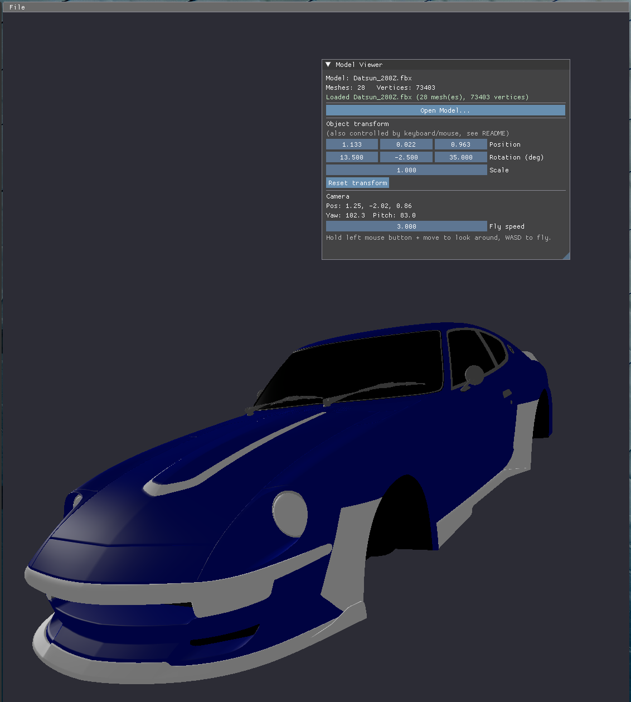

# Vulkan based 3D object viewer



## Build

for fbx support, install assimp also.
```sh
sudo pacman -S vulkan-headers assimp

mkdir build
cd build
cmake -DCMAKE_BUILD_TYPE=Debug ..
```

For debugging:
```sh
gdb -q ./model_viewer -ex run -ex bt -ex quit

gdb -q ./model_viewer -ex run -ex 'bt full' -ex quit
```

## Use

Yeah, tobedone. use mouse and keyboard.

## The use of AI

Yes, this project has been created with the help of an "ai" or LLM. Actually, I asked Claude, but it was partially helpfull and chatgpt had to come in and help alott. So in the end, I think we must thank ChatGPT for the most work. 

The initial prompt was:

``Can you make me a Vulkan linux program in C++, that will work on a eGPU less Framework 13, 12th gen intel. 
the app has to be able to load objects and textures that for example i donwloaded from https://sketchfab.com/.  obj, fbx or mtl files I have and the textures are closeby in a folder, so maybe a imgui file selection menu? I wanna be able to move the object arround with keybaord and mouse.``

Ill try to keep my understanding of the code high, and do not recommend to use this code in production or without a code review yourself. If the amount of code I understand and or altered by my myself reached a certain threshold, i might change this AI disclaimer.

Ow, and this part has most of the text now. lol. and none of this readme is llm.

## License

Can we license llm generated code? if so, MIT, good luck.